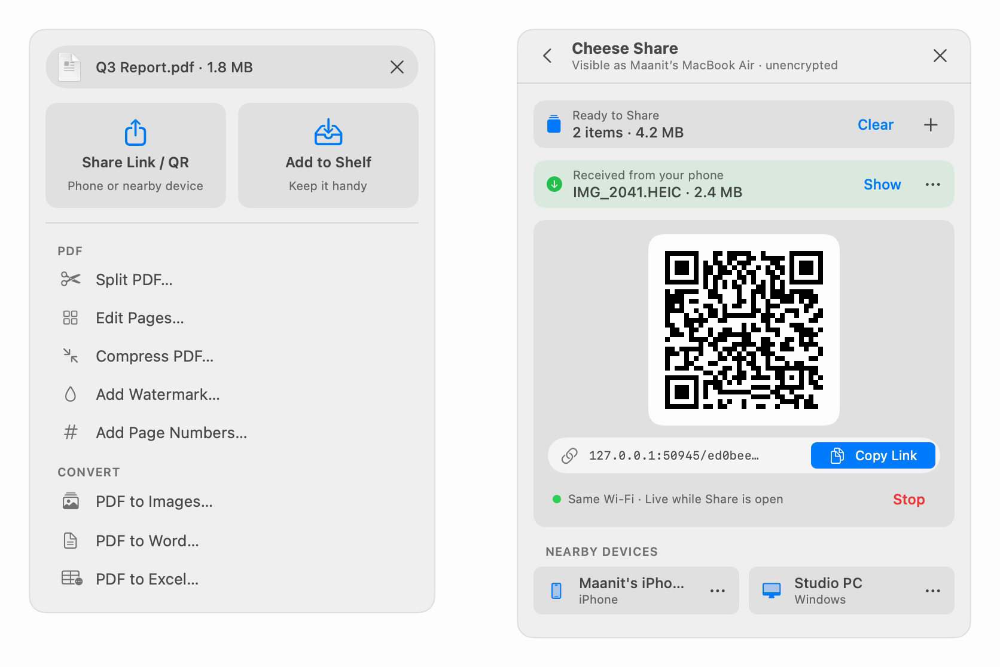
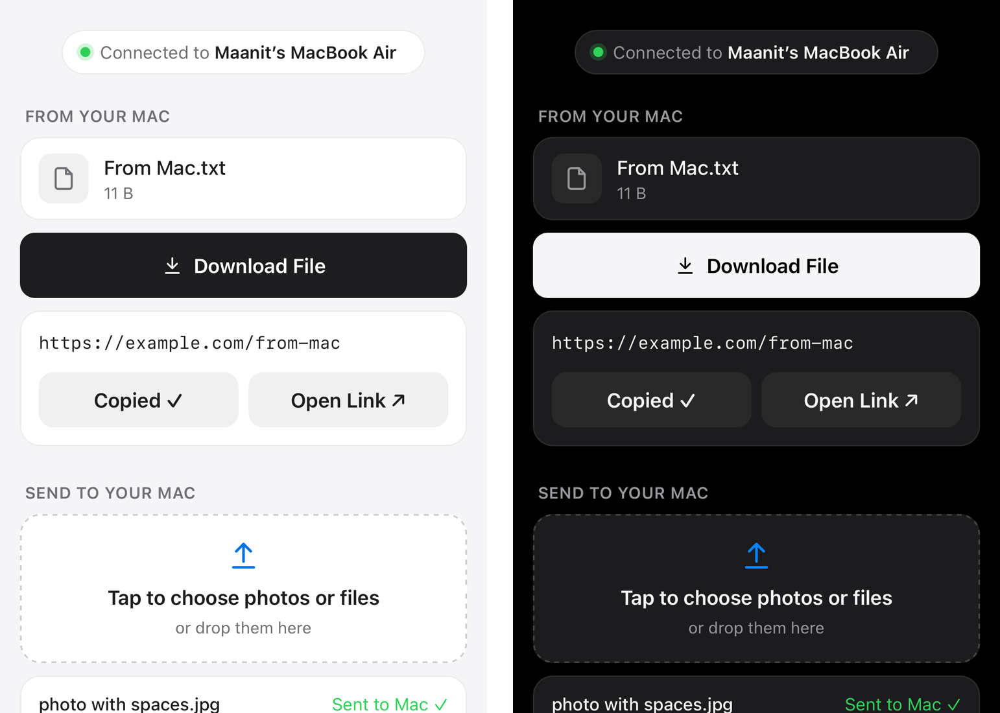

<p align="center">
  
</p>

<h1 align="center">Cheese</h1>

<p align="center">
  <b>The Swiss Army knife for your Mac.</b><br>
  Every little tool your Mac forgot.
</p>

<p align="center">
  <a href="https://github.com/maanit-gupta/Cheese/releases/latest"></a>
  
  
  <a href="LICENSE"></a>
</p>

<p align="center">
  <a href="https://github.com/maanit-gupta/Cheese/raw/main/docs/media/cheese-promo.mp4">
    
  </a>
  <br>
  <sub>▶︎ <a href="https://github.com/maanit-gupta/Cheese/raw/main/docs/media/cheese-promo.mp4">Watch the full video</a> (MP4, 81 s)</sub>
</p>

Cheese lives in your menu bar and stays out of the way until you press a shortcut. Every tool is also one click away in its menu, any tool you don't need can be switched off, and every shortcut can be changed. It all runs on your Mac: no account, no cloud, no telemetry.

**[Copy](#copy)** · **[Capture](#capture)** · **[Draw](#draw)** · **[Convert](#convert)** · **[Share](#share)** · **[Control](#control)** · [Shortcuts](#keyboard-shortcuts) · [Permissions](#permissions) · [Install](#install) · [Privacy](#privacy) · [Build from source](#build-from-source)

---

## Copy

Keep everything you copy, find it in a keystroke, and get it where it needs to go.

**Clipboard history** <kbd>⌃</kbd><kbd>⌥</kbd><kbd>V</kbd>
- Remembers text, rich text (it pastes back with its formatting), images and files, and survives restarts.
- Opens under the menu bar icon with the search field ready: type to fuzzy-search, including **the words inside copied screenshots**, which Cheese reads in the background.
- <kbd>↩</kbd> pastes into the app you were in, <kbd>⌥</kbd><kbd>↩</kbd> pastes plain text, <kbd>⌘</kbd><kbd>1</kbd>…<kbd>9</kbd> pastes instantly. <kbd>⌘</kbd><kbd>P</kbd> pins favourites so they never expire.
- Skips anything a password manager marks as secret.

**Drag to chat, edit in place**
- **Drag any item straight out of the history** (a row, or the image or file in the preview) into Messages, Slack, Discord, WhatsApp, a browser chat, Mail or Finder. The history fades while you aim, then closes after the drop. Images travel as both a file and image data, so web chats and native apps both accept them.
- **Fix text before you send it:** click the small ✏️ in the bottom-right corner of a text preview (or press <kbd>⌘</kbd><kbd>E</kbd>), edit in place, then <kbd>⌘</kbd><kbd>↩</kbd> to paste or grab the drag handle to drop the edited text into a chat. The edit replaces the item rather than adding a copy.

**Show Clipboard as QR** (menu bar → **Tools**, or the palette)
- Short text and links go straight into a QR code for your phone's camera.
- Anything bigger (long text, images, files, folders) becomes a **10-minute local Wi-Fi link** with **Copy Link**, a live countdown and **Stop**. Scanning it opens the same clean page as [Cheese Share](#share).

## Capture

Screenshots go straight to the clipboard at full Retina resolution, or into a folder, or both: pick under **Capture ▸ After Capture** or in **Settings → General**.

| Shortcut | Does |
|---|---|
| <kbd>⌃</kbd><kbd>⌥</kbd><kbd>4</kbd> | Drag a region on any display |
| <kbd>⌃</kbd><kbd>⌥</kbd><kbd>5</kbd> | Click a window, shadow and all |
| <kbd>⌃</kbd><kbd>⌥</kbd><kbd>3</kbd> | The display under the pointer |
| <kbd>⌃</kbd><kbd>⌥</kbd><kbd>T</kbd> | **Copy text** from any region: videos, images, locked PDFs, slides. English and Hindi. QR codes and barcodes too, and links get an *Open* button |
| <kbd>⌃</kbd><kbd>⌥</kbd><kbd>S</kbd> | **Scrolling capture:** pick an area and Cheese scrolls and stitches one tall image, keeping sticky headers once. It's copied or saved like any capture, and a preview lets you copy, save, annotate or read its text |

**Hold <kbd>⇧</kbd> as you finish** any capture to open the annotation editor instead: arrows, boxes, text, highlighter, blur, crop and undo, then **Copy** or **Save** as PNG.

## Draw

Draw on top of everything on screen, including full-screen apps, with the mouse or trackpad alone.

- **Tap** <kbd>⌃</kbd><kbd>⌥</kbd><kbd>D</kbd> for a canvas over every display. **Hold** it for quick ink: draw while it's held, and when you let go your clicks pass back to the apps underneath. Perfect for circling something on a call.
- Ink keeps up with fast strokes: it thins with speed, thickens with pressure and tapers at the ends.
- **Magic pen:** draw a rough rectangle, circle, triangle, line or arrow, pause for a moment, and it snaps into a clean shape. Handwriting stays handwriting. **Scratch out** ink with a quick zig-zag.
- **Hold the right button** for a radial menu (magic pen, highlighter, eraser, text, stamps, sticky notes, zoom and laser, with colors around the edge), or just **flick** toward a tool.
- Hold <kbd>⇧</kbd> for straight lines, <kbd>⌘</kbd> to erase, <kbd>⌥</kbd> to highlight. Scroll for size, <kbd>⇧</kbd> + scroll for color, pinch to zoom, double-click to type.
- Presenting? Laser pointer, spotlight, zoom lens, disappearing ink, neon pen, numbered stamps, and a whiteboard or blackboard. **Snapshot** (<kbd>⌘</kbd><kbd>⇧</kbd><kbd>S</kbd>) copies the screen with your drawings.

## Convert

Like iLovePDF, but **entirely offline**. No file leaves your Mac. Results are saved next to the original (`Report.pdf` → `Report (compressed).pdf`), and nothing is ever overwritten.

| | Tools |
|---|---|
| **PDF** | Merge (keeps bookmarks) · Split by ranges, every N pages or each page · Page editor (reorder, rotate, delete, extract) · **Compress to a target size** · Watermark · Page numbers |
| **To PDF** | Images (HEIC included) · Word · Excel / CSV · PowerPoint · HTML, Markdown and text |
| **From PDF** | Images (72–300 DPI) · Word (.docx) · Excel (.xlsx) |
| **Images** | Convert format · Resize · Compress (strips location data) · Remove background |
| **Text** | Markdown or HTML → Word |

Three ways in, each listing only the tools that fit your files: **right-click in Finder → Cheese ▸**, **drop files on the menu bar icon**, or type "Files:" in the command palette. A small panel shows your files and options, progress shows next to the icon, and a notification offers **Show in Finder** when it's done. Office rendering is built in and approximate; see the [known limits](docs/GUIDE.md#convert-offline-pdf-document-and-image-tools).

## Share

Get things from your Mac to a phone, a PC or another Mac nearby, and back, with no account and no cloud.

**Drop anything on the menu bar icon**

Drag files, a picture from a browser, a link or a text selection onto the 🧀. It lights up, and a small drop hub opens right under it:

<p align="center"></p>

- **Share Link / QR** puts it in Cheese Share and shows its link and QR code at once.
- **Add to Shelf** parks it on the [Shelf](#share).
- Below them come the **Files** tools that fit (PDF, Convert, Images), with your files already in.

**Cheese Share** (menu bar → **Share…**, the palette, the Shelf's **Send…**, or any app's Share menu)
- **Ready to Share:** drop files anywhere on the panel, click **+**, or click **Share Clipboard**.
- **One link for everything:** scan the QR code with a phone, or **Copy Link** and open it in any browser on the same Wi-Fi. No app needed.
- **What comes back lands in the panel:** files sent from a phone or another device appear in a green **Received** strip. **Show** reveals them in Finder, and **⋯** opens any one of them. The list stays after sharing stops, until you clear it.
- **LocalSend built in:** phones and computers running the free [LocalSend](https://localsend.org) app (Android, iPhone, Windows, Linux, Mac) appear under **Nearby devices**. Click one to send what's ready, or drop files straight onto it. They can send to you too, after you accept (or always, for your own devices). Transfers are encrypted.

**The page your phone opens** is clean and light, follows the phone's light or dark mode, and works over plain local Wi-Fi:

<p align="center"></p>

- **From your Mac:** files with **Download File** (or **Download All (.zip)**), picture previews, and text or links with **Copy Text** and **Open Link ↗**.
- **Send to your Mac:** tap to pick photos or files (or drag them in on a desktop) and watch them upload with a live progress bar, no page reloads. Paste text or a link and tap **Send** to put it on the Mac's clipboard and in its history.
- The page shows the time left and switches to *Expired — Reopen Share on your Mac* when the link stops.

**Shelf** <kbd>⌃</kbd><kbd>⌥</kbd><kbd>F</kbd>
- A floating shelf to park files, folders, images, text and links while you find where they go. Drop things on it, or click **+** / **Upload Files…**, or press <kbd>⌘</kbd><kbd>V</kbd>.
- Drag items (or the whole stack) out, and they leave the shelf, following Finder's move or copy rules. **Send…**, **Zip**, **Copy Paths**, **Quick Look** and the Files tools are in its toolbar. The shelf survives restarts.

## Control

Windows, apps and your Mac, on your terms.

- **Snap windows** <kbd>⌃</kbd><kbd>⌥</kbd> + <kbd>←</kbd> <kbd>→</kbd> <kbd>↑</kbd> <kbd>↓</kbd>: halves, maximize and bottom half, Windows-style. Press again to hop to the next display. <kbd>⌃</kbd><kbd>⌥</kbd><kbd>⌫</kbd> puts the window back.
- **Fill to Screen** <kbd>⌃</kbd><kbd>⌥</kbd><kbd>M</kbd>: resizes **every open window** to fill its display without entering native full screen, leaving room for **Stage Manager**'s strip so any tile you click comes up properly maximized. <kbd>⌃</kbd><kbd>⌥</kbd><kbd>⇧</kbd><kbd>M</kbd> does just the current window; **Restore All Windows** undoes it.
- **Auto-Kill** <kbd>⌃</kbd><kbd>⌥</kbd><kbd>Q</kbd>: one big **Kill All** button for every open app, with a 🔒 shield for the ones that should stay. Hold <kbd>⌥</kbd> to force-kill. <kbd>⌃</kbd><kbd>⌥</kbd><kbd>⇧</kbd><kbd>Q</kbd> sweeps without asking. Cheese and Finder are always spared.
- **App hotkeys** <kbd>⌃</kbd><kbd>⌥</kbd><kbd>⌘</kbd> + a letter: give any app its own shortcut to open or bring it forward. Cheese suggests a free, memorable key.
- **Keep Awake** (menu → **Tools**): indefinitely or until a time, with a countdown next to the icon.
- **Command palette** <kbd>⌃</kbd><kbd>⌥</kbd><kbd>↩</kbd>: search and run any Cheese action. It shows each one's shortcut, so you learn them as you go.

---

## Keyboard shortcuts

Every shortcut can be changed or turned off in **Settings → Shortcuts**, and the menu bar menu always shows your current ones.

| Action | Default |
|---|---|
| Clipboard history | <kbd>⌃</kbd><kbd>⌥</kbd><kbd>V</kbd> |
| Capture region · window · full screen | <kbd>⌃</kbd><kbd>⌥</kbd><kbd>4</kbd> · <kbd>⌃</kbd><kbd>⌥</kbd><kbd>5</kbd> · <kbd>⌃</kbd><kbd>⌥</kbd><kbd>3</kbd> (hold <kbd>⇧</kbd> to annotate) |
| Copy text from screen (OCR) | <kbd>⌃</kbd><kbd>⌥</kbd><kbd>T</kbd> |
| Scrolling capture | <kbd>⌃</kbd><kbd>⌥</kbd><kbd>S</kbd> |
| Draw on screen (tap to toggle, hold for quick ink) | <kbd>⌃</kbd><kbd>⌥</kbd><kbd>D</kbd> |
| Shelf | <kbd>⌃</kbd><kbd>⌥</kbd><kbd>F</kbd> |
| Snap left / right half | <kbd>⌃</kbd><kbd>⌥</kbd><kbd>←</kbd> / <kbd>→</kbd> |
| Maximize · bottom half | <kbd>⌃</kbd><kbd>⌥</kbd><kbd>↑</kbd> · <kbd>⌃</kbd><kbd>⌥</kbd><kbd>↓</kbd> |
| Restore window | <kbd>⌃</kbd><kbd>⌥</kbd><kbd>⌫</kbd> |
| Fill all windows · fill current window | <kbd>⌃</kbd><kbd>⌥</kbd><kbd>M</kbd> · <kbd>⌃</kbd><kbd>⌥</kbd><kbd>⇧</kbd><kbd>M</kbd> |
| Auto-Kill panel · kill all now | <kbd>⌃</kbd><kbd>⌥</kbd><kbd>Q</kbd> · <kbd>⌃</kbd><kbd>⌥</kbd><kbd>⇧</kbd><kbd>Q</kbd> |
| Command palette | <kbd>⌃</kbd><kbd>⌥</kbd><kbd>↩</kbd> |
| Your app hotkeys | <kbd>⌃</kbd><kbd>⌥</kbd><kbd>⌘</kbd> + a letter or digit |
| Cheese Share | none by default (assign one in Settings) |

Inside the clipboard history: type to search · <kbd>↑</kbd> <kbd>↓</kbd> to move · <kbd>↩</kbd> paste · <kbd>⌥</kbd><kbd>↩</kbd> plain text · <kbd>⌘</kbd><kbd>1</kbd>…<kbd>9</kbd> quick paste · <kbd>⌘</kbd><kbd>P</kbd> pin · <kbd>⌘</kbd><kbd>⌫</kbd> delete · <kbd>⌘</kbd><kbd>E</kbd> edit text · drag to drop into any app · <kbd>Esc</kbd> close.

While drawing: right button for tools · <kbd>⇧</kbd> line · <kbd>⌘</kbd> erase · <kbd>⌥</kbd> highlight · scroll for size · <kbd>⌘</kbd><kbd>Z</kbd> undo · <kbd>Esc</kbd> hide. The [guide](docs/GUIDE.md#keyboard-shortcuts) has the rest.

## Permissions

On first launch, a short welcome lets you pick your tools and then asks **only for the permissions those need**, each with a **Grant** button and live status. Everything is skippable, and **Settings → Permissions** shows the same status later.

| Permission | Needed for |
|---|---|
| **Screen Recording** | Screenshots, OCR, scrolling capture, and draw mode's snapshot and zoom |
| **Accessibility** | Pasting from history, window snapping, Fill to Screen, auto-scrolling |
| **Notifications** | Finished Files jobs, files received through Cheese Share |
| **Local Network** | Cheese Share finding nearby LocalSend devices |
| **Finder extension** | The **Cheese ▸** menu in Finder (turn it on in **Settings → Files**) |

Running a Files tool from the palette with Finder in front asks once for **Automation → Finder**, so Cheese can read Finder's selection.

## Install

Requires **macOS 15 Sequoia** or later on an Apple silicon Mac. Paste this into **Terminal**:

```sh
curl -fsSL https://raw.githubusercontent.com/maanit-gupta/Cheese/main/install.sh | bash
```

The [script](install.sh) downloads the latest release, checks its SHA-256, installs it to `/Applications` and opens Cheese.

Or download **`Cheese.zip`** from the [latest release](https://github.com/maanit-gupta/Cheese/releases/latest), unzip it and drag **Cheese.app** into **Applications**. Cheese isn't notarized by Apple, so macOS blocks the first launch:

1. Open **System Settings → Privacy & Security** and scroll to *"Cheese" was blocked…*.
2. Click **Open Anyway** and confirm. You only do this once.

Good to know:
- Sharing over Wi-Fi may show the **macOS firewall** prompt (if your firewall is on) and a **Local Network** prompt. Allow both, or phones can't reach your Mac.
- **Keep Awake can't keep the Mac awake with the lid closed.** That needs a privileged helper, which Cheese doesn't install.

The [install guide](docs/INSTALL.md) covers updating, uninstalling and fixes for common problems, and the [guide](docs/GUIDE.md) covers every tool in detail.

## Privacy

Everything runs on your Mac. No accounts, no telemetry, no cloud.

- Files are converted on your Mac and never uploaded. The Office renderers are bundled and blocked from loading anything remote.
- The only network use is sharing on **your own local network**, and nothing listens unless you ask. Show Clipboard as QR links expire after 10 minutes. Cheese Share listens only while its panel is open and for 10 minutes after, with a fresh random link each time.
- The phone page is entirely self-contained: no outside scripts, fonts or trackers.
- Items that password managers mark as secret are never recorded.

## Build from source

```sh
brew install xcodegen
git clone https://github.com/maanit-gupta/Cheese.git && cd Cheese
make run
```

Set `DEVELOPMENT_TEAM` in `project.yml` to your own Apple team ID first (a free personal team works). The Xcode project is generated, so edit `project.yml` rather than `Cheese.xcodeproj`.

| Command | Does |
|---|---|
| `make build` | Debug build (must finish with zero warnings) |
| `make test` | Unit tests, then the app size budget check |
| `make run` | Build and open the app |
| `make release` | Release build, zipped to `dist/Cheese.zip` with its `.sha256` |

Architecture, tests, the phone page in WebKit and releases are in [docs/DEVELOPMENT.md](docs/DEVELOPMENT.md); design notes and tokens are in [docs/DESIGN.md](docs/DESIGN.md); the LocalSend implementation is in [docs/LOCALSEND.md](docs/LOCALSEND.md); the promo video is rebuilt from [Design/promo](Design/promo/README.md).

Bug reports and pull requests are welcome; please open an issue first for anything big.

## License

[MIT](LICENSE) © 2026 Maanit Gupta. Global shortcuts use [KeyboardShortcuts](https://github.com/sindresorhus/KeyboardShortcuts) by Sindre Sorhus (MIT).
