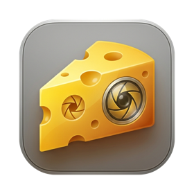

<p align="center">
  
</p>

<h1 align="center">Cheese</h1>

<p align="center">
  <b>Five everyday Mac tools in one tiny menu bar app.</b><br>
  Clipboard history · Screenshots · OCR · Scrolling capture · Window snapping
</p>

<p align="center">
  <a href="https://github.com/maanit-gupta/Cheese/releases/latest"></a>
  
  
  
  <a href="LICENSE"></a>
</p>

<p align="center">
  <a href="https://github.com/maanit-gupta/Cheese/releases/latest"><b>Download</b></a> ·
  <a href="docs/INSTALL.md"><b>Install guide</b></a> ·
  <a href="#keyboard-shortcuts"><b>Shortcuts</b></a> ·
  <a href="#troubleshooting"><b>Troubleshooting</b></a>
</p>

<p align="center">
  <a href="https://github.com/maanit-gupta/Cheese/raw/main/docs/media/cheese-promo.mp4">
    
  </a>
  <br>
  <sub>▶︎ <a href="https://github.com/maanit-gupta/Cheese/raw/main/docs/media/cheese-promo.mp4">Watch the full-quality video (MP4)</a></sub>
</p>

---

Cheese replaces a handful of single-purpose utilities (a clipboard manager, a screenshot tool, a text grabber and a window manager) with one native app. It lives in your menu bar, starts instantly and stays out of the way until you press a shortcut.

- **Native.** Swift 6, SwiftUI and AppKit, built on ScreenCaptureKit, Vision and Accessibility. No Electron and no web views.
- **Private.** Everything stays on your Mac. No accounts, analytics or network calls. Items that password managers mark as secret are never recorded.
- **Yours to tweak.** Every shortcut can be changed, and the source is MIT licensed.

## Features

### 📋 Clipboard history
- Remembers text, rich text (pastes back with formatting), images and files.
- <kbd>⌃</kbd><kbd>⌥</kbd><kbd>V</kbd> opens the history under the menu bar icon. Start typing to fuzzy-search.
- Search also matches **text inside copied images**, which Cheese reads in the background.
- <kbd>↩</kbd> pastes into the app you were using, <kbd>⌥</kbd><kbd>↩</kbd> pastes as plain text, and <kbd>⌘</kbd><kbd>1</kbd>…<kbd>9</kbd> pastes instantly.
- Pin favourites with <kbd>⌘</kbd><kbd>P</kbd>. Pinned items never expire. Keeps your last 200 items (adjustable).
- Skips anything a password manager marks as concealed or transient.

### 📸 Screenshots
- **Region** <kbd>⌃</kbd><kbd>⌥</kbd><kbd>4</kbd>, **full screen** <kbd>⌃</kbd><kbd>⌥</kbd><kbd>3</kbd> and **window** <kbd>⌃</kbd><kbd>⌥</kbd><kbd>5</kbd> (with its shadow).
- Copied straight to the clipboard at full Retina resolution. Nothing clutters your desktop.
- **Hold <kbd>⇧</kbd> as you finish** to open the annotation editor: arrows, boxes, text, highlighter, blur, crop, and undo/redo. Save as PNG or copy.

### 🔤 Copy text from anything (OCR)
- <kbd>⌃</kbd><kbd>⌥</kbd><kbd>T</kbd>, then drag over any part of the screen: videos, images, locked PDFs or slides.
- Recognises **English and Hindi**. You choose whether to keep line breaks or join them into paragraphs.
- **QR codes and barcodes** are read too. Links get an *Open* button.

### 📜 Scrolling capture
- <kbd>⌃</kbd><kbd>⌥</kbd><kbd>S</kbd>, then select the scrollable area. Cheese scrolls for you and stitches one tall image.
- Sticky headers and footers are detected and kept once, not repeated.
- Stops by itself at the end of the page, or when you press <kbd>Esc</kbd>. Then copy, save, annotate or OCR the result.

### 🪟 Window snapping
- <kbd>⌃</kbd><kbd>⌥</kbd><kbd>←</kbd> / <kbd>→</kbd> snaps to the left or right half, <kbd>↑</kbd> maximizes and <kbd>↓</kbd> snaps to the bottom half.
- Press <kbd>→</kbd> again on the right half to jump to the next display, Windows-style.
- <kbd>⌃</kbd><kbd>⌥</kbd><kbd>⌫</kbd> puts the window back where it was.

## Install

> **Requirements:** macOS 27 or later on an Apple silicon Mac.

### Option 1: one-line install (recommended)

Paste this into **Terminal**:

```sh
curl -fsSL https://raw.githubusercontent.com/maanit-gupta/Cheese/main/install.sh | bash
```

The [script](install.sh) downloads the latest release, verifies its checksum, installs it to `/Applications`, clears the Gatekeeper quarantine flag and opens Cheese. It's short; read it first if you like.

### Option 2: download the zip

1. Download **`Cheese.zip`** from the [latest release](https://github.com/maanit-gupta/Cheese/releases/latest). It's a plain zip, not a disk image.
2. Double-click it to unzip, then drag **Cheese.app** into **Applications**.
3. Open Cheese. macOS will block the first launch because Cheese isn't notarized by Apple:
   - Go to **System Settings → Privacy & Security** and scroll down to *"Cheese" was blocked…*.
   - Click **Open Anyway** and confirm with your password or Touch ID.

   You only do this once. Prefer Terminal? `xattr -dr com.apple.quarantine /Applications/Cheese.app` does the same.

### Option 3: build from source

```sh
brew install xcodegen
git clone https://github.com/maanit-gupta/Cheese.git && cd Cheese
make run
```

Set `DEVELOPMENT_TEAM` in `project.yml` to your own Apple team ID first. A free personal team works.

📖 **The [full install guide](docs/INSTALL.md)** covers each step in detail, plus updating, uninstalling and fixes for common problems.

## First launch

Cheese opens a short **welcome guide** the first time it runs:

1. **What Cheese does**, with the shortcut for each tool.
2. **Permissions.** Cheese needs two, and both are granted in System Settings → Privacy & Security:

   | Permission | Needed for |
   |---|---|
   | **Screen Recording** | Screenshots, OCR, scrolling capture |
   | **Accessibility** | Pasting from history, window snapping, auto-scrolling |

   You can skip this step. Cheese asks the first time a feature needs a permission.
3. **Shortcuts.** Rebind anything you like right there.
4. **Launch at login**, if you want it.

After that, look for the 🧀 wedge in your menu bar. **Click it to open the Cheese menu.** Every feature is there, so shortcuts are optional:

```
 Clipboard History                ⌃⌥V
 ───────────────────────────────────
 CAPTURE
 Capture Region                   ⌃⌥4
 Capture Window                   ⌃⌥5
 Capture Full Screen              ⌃⌥3
 Scrolling Capture                ⌃⌥S
 TEXT
 Copy Text from Screen            ⌃⌥T
 WINDOWS
 Arrange Window                     ▸
 ───────────────────────────────────
 Clear History
 Clear All…
 ───────────────────────────────────
 Keyboard Shortcuts…
 Settings…                         ⌘,
 Welcome Guide…
 Quit Cheese                       ⌘Q
```

The shortcuts shown are your current ones, and they update when you change them. **Welcome Guide…** reopens the guide.

## Keyboard shortcuts

| Action | Default |
|---|---|
| Open clipboard history | <kbd>⌃</kbd><kbd>⌥</kbd><kbd>V</kbd> |
| Capture region | <kbd>⌃</kbd><kbd>⌥</kbd><kbd>4</kbd> |
| Capture full screen | <kbd>⌃</kbd><kbd>⌥</kbd><kbd>3</kbd> |
| Capture window | <kbd>⌃</kbd><kbd>⌥</kbd><kbd>5</kbd> |
| Copy text from region (OCR) | <kbd>⌃</kbd><kbd>⌥</kbd><kbd>T</kbd> |
| Scrolling capture | <kbd>⌃</kbd><kbd>⌥</kbd><kbd>S</kbd> |
| Snap left / right half | <kbd>⌃</kbd><kbd>⌥</kbd><kbd>←</kbd> / <kbd>→</kbd> |
| Maximize | <kbd>⌃</kbd><kbd>⌥</kbd><kbd>↑</kbd> |
| Snap bottom half | <kbd>⌃</kbd><kbd>⌥</kbd><kbd>↓</kbd> |
| Restore window | <kbd>⌃</kbd><kbd>⌥</kbd><kbd>⌫</kbd> |

### Changing shortcuts

Click the menu bar icon and choose **Keyboard Shortcuts…** (or go to **Settings → Shortcuts**).

- **Click** a shortcut, then **press the new keys**.
- Click **ⓧ** to turn a shortcut off.
- **Restore Defaults** puts everything back.

Cheese warns you if a combination is already taken by macOS or the menu. The menu bar menu always shows your current bindings.

### Inside the clipboard history

| Key | Action |
|---|---|
| Type | Filter (fuzzy search) |
| <kbd>↑</kbd> / <kbd>↓</kbd> | Move selection |
| <kbd>↩</kbd> | Paste into the previous app |
| <kbd>⌥</kbd><kbd>↩</kbd> | Paste as plain text |
| <kbd>⌘</kbd><kbd>1</kbd> … <kbd>⌘</kbd><kbd>9</kbd> | Paste the Nth item |
| <kbd>⌘</kbd><kbd>P</kbd> | Pin / unpin |
| <kbd>⌘</kbd><kbd>⌫</kbd> | Delete item |
| <kbd>Esc</kbd> | Close |

## Settings

| Tab | What's there |
|---|---|
| **General** | Launch at login, screenshot save folder (default: Desktop), welcome guide |
| **Shortcuts** | Rebind every global shortcut |
| **Clipboard** | History size (default 200 unpinned items) |
| **OCR** | Languages (English, Hindi) and line-break handling |
| **Permissions** | Live status of Screen Recording and Accessibility, with shortcuts to System Settings |

## Troubleshooting

<details>
<summary><b>"Cheese can't be opened" or "Apple could not verify…"</b></summary>

Cheese isn't notarized. Open **System Settings → Privacy & Security** and click **Open Anyway**, or run:

```sh
xattr -dr com.apple.quarantine /Applications/Cheese.app
```
</details>

<details>
<summary><b>Screenshots only show the wallpaper, or capture does nothing</b></summary>

Turn on **Cheese** under **System Settings → Privacy & Security → Screen Recording**, then quit Cheese (menu bar icon → Quit Cheese) and open it again.
</details>

<details>
<summary><b>Choosing an item in history copies it but doesn't paste</b></summary>

Pasting needs **Accessibility** access. Turn on Cheese under **Privacy & Security → Accessibility**. If it's already on but still doesn't work (for example after an update), select Cheese in that list, remove it with **–**, and add it again.
</details>

<details>
<summary><b>A shortcut doesn't do anything</b></summary>

Another app may already be using it. Pick **Keyboard Shortcuts…** from the menu bar icon and choose a different combination.
</details>

<details>
<summary><b>I can't see the icon in the menu bar</b></summary>

On MacBooks with a notch, a crowded menu bar can hide icons. Quit a few other menu bar apps, or hold <kbd>⌘</kbd> and drag icons to rearrange them. Your shortcuts keep working even while the icon is hidden.
</details>

More fixes are in the [install guide](docs/INSTALL.md#troubleshooting).

## Uninstall

Quit Cheese, then:

```sh
rm -rf /Applications/Cheese.app "$HOME/Library/Application Support/Cheese"
defaults delete com.maanitgupta.cheese
tccutil reset ScreenCapture com.maanitgupta.cheese
tccutil reset Accessibility com.maanitgupta.cheese
```

If you turned on launch at login, also remove Cheese from **System Settings → General → Login Items**.

## Development

```sh
make generate   # regenerate Cheese.xcodeproj from project.yml (XcodeGen)
make build      # Debug build
make test       # unit tests (Swift Testing)
make run        # build and launch
make release    # Release build → dist/Cheese.zip + SHA-256
```

The Xcode project is generated, so edit `project.yml` rather than `Cheese.xcodeproj`. The code is organised by feature (`Clipboard/`, `Capture/`, `OCR/`, `ScrollCapture/`, `Windows/`, `Editor/`, `Welcome/`, `Settings/`), with the wiring in `App/`. Pure logic (fuzzy matching, stitching, sticky-header detection, snap geometry and display coordinate conversion) has no AppKit dependencies and is covered by unit tests. [`CLAUDE.md`](CLAUDE.md) has the full spec and architecture notes.

**Publishing a release:** bump `MARKETING_VERSION` in `project.yml`, run `make release`, then:

```sh
gh release create v0.x.y dist/Cheese.zip dist/Cheese.zip.sha256 --title "Cheese 0.x.y" --notes "…"
```

Keep the asset named `Cheese.zip`. The install script and download links point at `releases/latest/download/Cheese.zip`.

## Contributing

Bug reports and pull requests are welcome. Please open an issue first for anything big. Run `make test` before sending a PR. The build treats warnings as errors.

## License

[MIT](LICENSE) © 2026 Maanit Gupta. Global shortcuts use [KeyboardShortcuts](https://github.com/sindresorhus/KeyboardShortcuts) by Sindre Sorhus (MIT).
